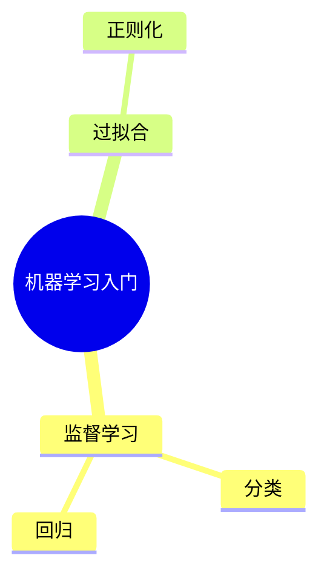

# 测试视频：机器学习入门

> 学科：人工智能 ｜ UP：测试UP ｜ BV：BV1xx411c7mD

## 学习目标
- 理解监督学习
- 掌握训练/验证/测试集

## 核心知识点
- **监督学习**
  - 用带标签数据训练
  - 常见任务：分类、回归
- **过拟合**
  - 训练集表现好，测试集差
  - 用正则化缓解

## 关键概念与术语
- **损失函数**：衡量预测与真实值的差距

## 弹幕与评论区洞察
- 观众关注“如何调参”
- 有人补充了交叉验证

## 思维导图

## 复习清单
- [ ] 用自己的话解释过拟合

## 内容来源与覆盖度
- 抓取覆盖：视频简介 · 弹幕 10 条 · 热评 3 条
- 说明：测试
